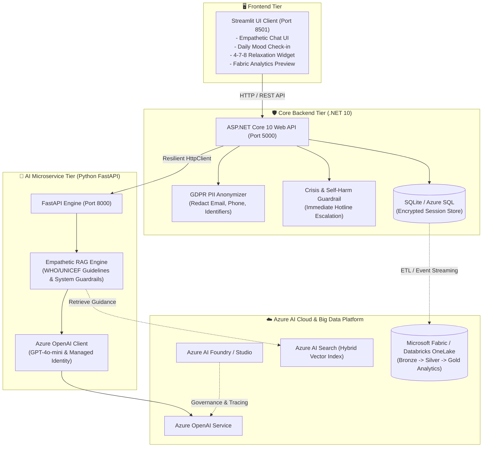
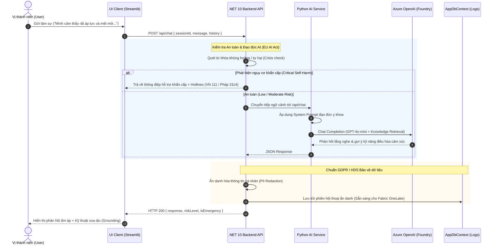

# 🌿 The Inner Voice (Tiếng Lòng)
### *Responsible AI & Multimodal Mental Health Platform for Adolescents*
> **A Scalable Cloud-Native Ecosystem built with .NET 10, Python FastAPI, Azure AI Foundry, and Microsoft Fabric / Databricks (DP-800 Alignment).**  
> *Designed in compliance with the **EU AI Act** (High-Risk Healthcare Category) and **GDPR / French HDS** standards for European & French Academic Research Applications.*

---

## 📌 1. Giới thiệu dự án (Project Overview)

**The Inner Voice** là nền tảng số hỗ trợ và đồng hành chăm sóc sức khỏe tâm thần cho lứa tuổi thanh thiếu niên (vị thành niên). Dự án giải quyết bài toán cấp bách về khủng hoảng tâm lý học đường, áp lực đồng trang lứa và trầm cảm vị thành niên thông qua sự kết hợp giữa:
1. **Trí tuệ nhân tạo có trách nhiệm (Responsible AI):** Mô hình RAG (Retrieval-Augmented Generation) dựa trên cơ sở khoa học tâm lý (CBT - Liệu pháp Nhận thức Hành vi), tích hợp bộ lọc an toàn và cơ chế phản ứng khẩn cấp (Crisis Escalation).
2. **Kiến trúc phân tán Microservices hiện đại:** Kết hợp sức mạnh xử lý nghiệp vụ, bảo mật và ẩn danh dữ liệu của **.NET 10** với năng lực tính toán AI linh hoạt của **Python (FastAPI & Azure AI Foundry)**.
3. **Kỹ thuật dữ liệu chuẩn mực (Data Engineering - DP-800):** Sẵn sàng tích hợp dữ liệu vào **Microsoft Fabric / Databricks** theo kiến trúc Medallion (Bronze - Silver - Gold) phục vụ nghiên cứu dịch tễ học sức khỏe tâm thần học đường.

---

## 🏛️ 2. Sơ đồ kiến trúc toàn hệ thống (System Architecture)



---

## 🔄 3. Quy trình tương tác & Luồng xử lý (End-to-End Workflow)



---

## 📂 4. Cấu trúc thư mục (Repository Structure)

| Thư mục | Nền tảng | Chức năng chính | Tài liệu chi tiết |
| :--- | :--- | :--- | :--- |
| [**`backend-service/`**](./backend-service) | **.NET 10 (C#)** | Gateway điều phối, bảo mật GDPR PII, kiểm soát rủi ro khẩn cấp và lưu trữ CSDL. | [Xem README](./backend-service/README.md) |
| [**`ai-service/`**](./ai-service) | **Python 3.11 / FastAPI** | Động cơ AI RAG tích hợp Azure OpenAI (GPT-4o-mini), Azure AI Search và Foundry. | [Xem README](./ai-service/README.md) |
| [**`ui-client/`**](./ui-client) | **Streamlit / Plotly** | Giao diện trò chuyện thân thiện cho vị thành niên, Mood check-in và Fabric Analytics demo. | [Xem README](./ui-client/README.md) |
| [**`docker-compose.yml`**](./docker-compose.yml) | Docker | Cấu hình triển khai trọn gói toàn bộ hệ thống bằng một câu lệnh duy nhất. | - |

---

## 🚀 5. Hướng dẫn khởi chạy nhanh (Quick Start)

### Cách 1: Khởi chạy trọn gói bằng Docker Compose (Khuyên dùng)
Yêu cầu: Máy đã cài đặt Docker và Docker Compose.
```bash
# Clone dự án và di chuyển vào thư mục gốc
cd the-inner-voice

# Xây dựng và khởi chạy cả 3 dịch vụ
docker-compose up --build
```
Sau khi khởi động thành công:
* **Giao diện người dùng (UI Client):** `http://localhost:8501`
* **Backend API (.NET 10 Swagger/OpenAPI):** `http://localhost:5000`
* **AI Microservice (FastAPI Docs):** `http://localhost:8000/docs`

---

### Cách 2: Khởi chạy thủ công từng dịch vụ (Development Mode)

#### 1. Khởi động AI Microservice (Python):
```powershell
cd ai-service
.\.venv\Scripts\Activate.ps1
pip install -r requirements.txt
uvicorn app.main:app --reload --port 8000
```

#### 2. Khởi động Backend API (.NET 10):
```powershell
cd backend-service
dotnet run
```

#### 3. Khởi động UI Client (Streamlit):
```powershell
cd ui-client
pip install -r requirements.txt
streamlit run app.py --server.port 8501
```

---

## 🎓 6. Định hướng Nghiên cứu & Hồ sơ Học bổng Pháp (Academic Statement)

Dự án này được thiết kế có chủ đích nhằm đáp ứng các tiêu chí học thuật khắt khe khi ứng tuyển học bổng Thạc sĩ / Tiến sĩ tại Pháp (như Học bổng Eiffel, Viện nghiên cứu INRIA, CNRS, Paris-Saclay, Sorbonne, IP Paris):
1. **Tuân thủ EU AI Act:** Sức khỏe tâm thần vị thành niên thuộc nhóm *High-Risk AI Systems*. Dự án minh chứng khả năng thiết kế hệ thống có cơ chế kiểm soát của con người (*Human-in-the-loop*), giảm thiểu định kiến, và minh bạch nguồn tri thức tham chiếu.
2. **Bảo vệ quyền riêng tư y tế (GDPR & HDS Compliance):** Tích hợp tầng `PiiAnonymizer` độc lập để bảo đảm quyền riêng tư tuyệt đối cho trẻ em.
3. **Chuẩn bị dữ liệu lớn (DP-800 & Microsoft Fabric):** Kiến trúc dữ liệu phân tầng sẵn sàng cho nghiên cứu hành vi tâm lý diện rộng thông qua OneLake, Delta Lake và PySpark.

---

## 📜 Giấy phép & Đóng góp
Dự án được xây dựng vì mục đích nghiên cứu học thuật, giáo dục và hỗ trợ cộng đồng. Mọi đóng góp xin vui lòng tạo Issue hoặc Pull Request trên GitHub.

